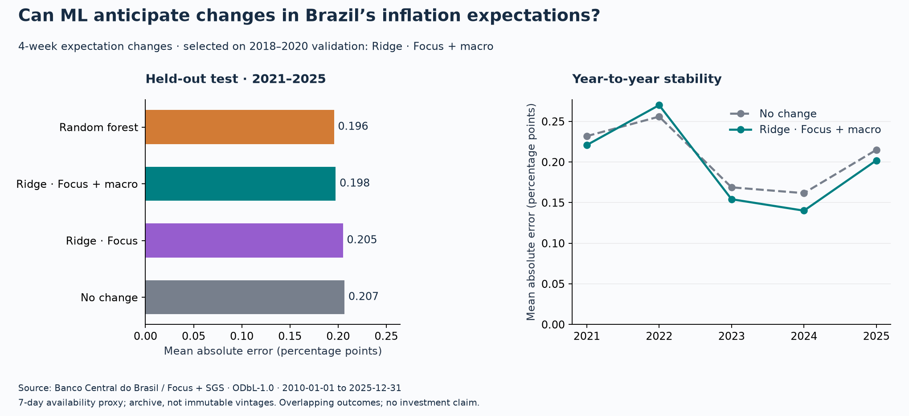

# Focus Signal Lab

[](https://github.com/felipercmb/focus-signal-lab/actions/workflows/ci.yml)

**Can simple ML models anticipate changes in Brazil's inflation expectations?**

A reproducible Python benchmark using public Banco Central do Brasil data:
Focus inflation expectations, the Selic target and the USD/BRL exchange rate.
The target is the **four-week change in smoothed rolling 12-month IPCA expectations**.
It measures expectations, not realized inflation.

The economic motivation is to investigate signals useful for monitoring changes
in the inflation outlook. The engineering goal is an experiment another developer
can inspect, test and reproduce without credentials or live API access.

## What the experiment found

The Ridge model with Focus and macro features won validation and achieved
**0.1975 percentage points MAE** on 2021–2025, compared with **0.2067** for
the no-change baseline: a **4.4% reduction** across 257 weekly test origins.

**The evidence is inconclusive:** the approximate 95% paired block-bootstrap
interval for its MAE difference is **[−0.0192, +0.0013] percentage points**, which
includes zero. It also underperformed the baseline in 2022. This is a measured
research result, not a claim of reliable forecasting or financial returns.

| Fixed candidate | Validation MAE, 2018–2020 | Test MAE, 2021–2025 | Test RMSE |
| --- | ---: | ---: | ---: |
| No change / persistence | 0.1649 | 0.2067 | 0.2729 |
| Ridge · Focus only | 0.1610 | 0.2050 | 0.2712 |
| **Ridge · Focus + macro — selected** | **0.1575** | **0.1975** | **0.2629** |
| Random forest · Focus + macro | 0.1624 | 0.1958 | 0.2604 |

All errors are in percentage points. The random forest's lower test error does
not change the selection: the winner was fixed using validation MAE before
evaluating test performance. There was no hyperparameter search.



[Full measured results](reports/benchmark/RESULTS.md) ·
[Every prediction](reports/benchmark/predictions.csv) ·
[Annual metrics](reports/benchmark/annual_metrics.csv) ·
[Run fingerprint and versions](reports/benchmark/run.json)

## Run it locally

Use **Python 3.12** for the recorded environment. Other declared Python versions
are not currently covered by CI. From a terminal:

```bash
git clone https://github.com/felipercmb/focus-signal-lab.git
cd focus-signal-lab
python3.12 -m venv .venv
source .venv/bin/activate
python -m pip install -r requirements.lock
python -m pip install --no-deps --no-build-isolation -e .

focus-lab check-data
pytest -q
focus-lab run
python scripts/verify_reproduction.py reports/benchmark reports/local
```

On Windows, activate with `.venv\Scripts\activate` and use `py -3.12` to create
the environment. Installation needs internet access; the checks and experiment
use the committed snapshot and work offline. Outputs go to `reports/local/`,
which is ignored by Git. The lock pins direct and transitive dependencies.

To fetch the same date range again from the public APIs into a **new** directory:

```bash
focus-lab download --output data/refreshed/2010-2025
focus-lab run --data data/refreshed/2010-2025 --output reports/local/refreshed
```

Historical API data can change. Refreshing creates a new experiment; it does
not overwrite the committed evidence. The evaluation dates remain fixed at
2018–2020 validation and 2021–2025 test even if a wider download is requested.

## How the evaluation works

```text
Public BCB APIs → raw responses + SHA-256 manifest → validated daily tables
  → Friday grid with availability lag → historical features + matured targets
  → expanding-window fits → validation-only selection → held-out test evidence
```

- **Information clock:** each Friday uses source observations dated at least
  seven days earlier. The extra age at that cutoff is limited to seven days.
  This is a conservative publication proxy, not a verified release calendar.
- **Target clock:** predict the change between the currently available median
  and the median available four calendar weeks later under the same proxy.
- **Training:** expanding history, refitted every 13 weeks. A training target's
  availability date must be strictly before the refit date. Scaling is fitted
  inside the training pipeline.
- **Features:** recent Focus changes and survey dispersion, Selic level/change,
  and past exchange-rate log changes. The Focus-only Ridge is an ablation.
- **Comparisons:** identical complete rows for all models; MAE, RMSE, annual
  breakdown and paired block-bootstrap uncertainty. Earlier matured test
  outcomes may enter later scheduled fits; test scores never choose the model.

[Methodology and exact settings](docs/METHODOLOGY.md) ·
[Data definitions and limitations](docs/DATA_CARD.md)

## Data and reproducibility

The frozen snapshot covers **2010-01-01 to 2025-12-31** and was retrieved on
**2026-11-05 UTC**. It contains 4,019 Focus rows, 5,844 Selic rows and 4,019 FX rows.
Each response, request URL and checksum is retained in
[`data/snapshot/manifest.json`](data/snapshot/manifest.json).

| Dataset | Use | Official source |
| --- | --- | --- |
| Focus smoothed 12-month IPCA, base 0 | Target median and survey dispersion | [BCB Focus](https://dadosabertos.bcb.gov.br/dataset/expectativas-mercado) |
| SGS 432: Copom Selic target | Interest-rate features, % per year | [BCB SGS 432](https://dadosabertos.bcb.gov.br/dataset/432-taxa-de-juros---meta-selic-definida-pelo-copom) |
| SGS 1: USD selling/PTAX reference | Exchange-rate features, BRL per USD | [BCB SGS 1](https://dadosabertos.bcb.gov.br/dataset/1-taxa-de-cambio---livre---dolar-americano-venda---diario) |

The API archive is not a collection of immutable historical vintages. Focus
statistics are calculated daily and published weekly; the lag does not prove
that every value matches what was available historically. The rolling target
also reflects horizon changes and respondent composition. Four-week outcomes
overlap, and the small macroeconomic sample spans changing regimes.

## Engineering checks

CI runs linting, formatting, unit tests, snapshot verification and a complete
offline benchmark reproduction on Python 3.12. Tests cover future-data
perturbation, calendar gaps, stale observations, target maturity, train-only
scaling, validation-only selection, tampering and matched uncertainty samples.

```bash
ruff check .
ruff format --check .
```

The repository intentionally keeps a compact package and CLI. Potential next
experiments include archived publication vintages, more conservative release
lags, alternative horizons and evaluation on genuinely unseen future years.
Once a test period informs new choices, it should be treated as development data.

## License

Code: [MIT](LICENSE). Banco Central source data and derived tables:
[ODbL-1.0](data/LICENSE.md). Retain the BCB attribution and data license when
reusing them. This is an independent educational project, not endorsed by BCB
and not financial advice.
