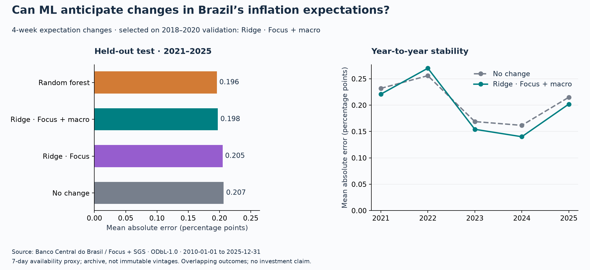

# Measured benchmark

Selected on validation MAE: **ridge_macro**. Test MAE: **0.1975 pp**;
persistence: **0.2067 pp**. Relative MAE improvement:
**4.4%**, across 257 matched test origins.
These are historical measurements, not evidence of deployable trading value.

| period | model | n | mae_pp | rmse_pp | skill_vs_persistence |
| --- | --- | --- | --- | --- | --- |
| test | persistence | 257 | 0.2067 | 0.2729 | 0.0000 |
| test | random_forest | 257 | 0.1958 | 0.2604 | 0.0525 |
| test | ridge_focus | 257 | 0.2050 | 0.2712 | 0.0078 |
| test | ridge_macro | 257 | 0.1975 | 0.2629 | 0.0443 |
| validation | persistence | 152 | 0.1649 | 0.2133 | 0.0000 |
| validation | random_forest | 152 | 0.1624 | 0.2112 | 0.0148 |
| validation | ridge_focus | 152 | 0.1610 | 0.2125 | 0.0237 |
| validation | ridge_macro | 152 | 0.1575 | 0.2147 | 0.0449 |

## Uncertainty

Approximate 95% paired moving-block intervals (13 consecutive weeks, 2,000 resamples).
The quantity is model MAE minus persistence MAE in percentage points; negative favors ML.
An interval crossing zero does not support a clear advantage on this diagnostic.
Overlapping four-week outcomes are not independent. These intervals condition on the
fitted prediction path and do not correct for candidate selection or all structural changes.

| model | mae_difference_pp | approximate_95pct_lower_pp | approximate_95pct_upper_pp |
| --- | --- | --- | --- |
| persistence | 0.0000 | 0.0000 | 0.0000 |
| random_forest | -0.0109 | -0.0236 | 0.0037 |
| ridge_focus | -0.0016 | -0.0105 | 0.0074 |
| ridge_macro | -0.0092 | -0.0192 | 0.0013 |

## How to audit

`predictions.csv` contains each origin, actual/predicted outcome, refit date and latest
training-label availability date. `features.csv` records input dates and exact target
alignment. `annual_metrics.csv` exposes year-to-year instability. `run.json` records
the snapshot fingerprint, software versions, selection rule and uncertainty settings.

Source: [Banco Central do Brasil](https://dadosabertos.bcb.gov.br/dataset/expectativas-mercado),
[SGS 432](https://dadosabertos.bcb.gov.br/dataset/432-taxa-de-juros---meta-selic-definida-pelo-copom),
[SGS 1](https://dadosabertos.bcb.gov.br/dataset/1-taxa-de-cambio---livre---dolar-americano-venda---diario).
Data and derived tables: [ODbL-1.0](https://opendatacommons.org/licenses/odbl/1-0/).
Current API archive; 7-day publication proxy,
not historically verified vintages. Source window: 2010-01-01 to
2025-12-31.
The target includes rolling-horizon and respondent-composition effects, not just beliefs.
